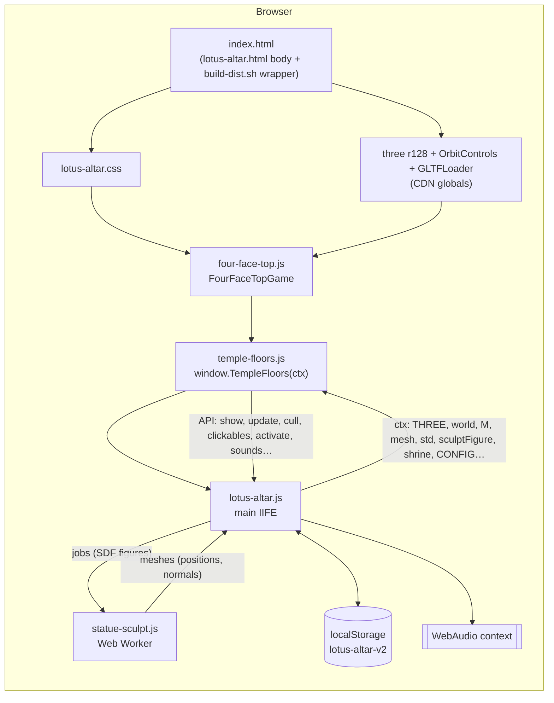

# Architecture

How Lotus Altar is put together: what loads, what gets built and when, what runs on every frame, and where the cost
goes. It is written as groundwork for performance work and for adding measurement. For the list of places, see
[SITEMAP.md](SITEMAP.md). For working rules, see [AGENTS.md](AGENTS.md).

## 1. Overview



- **No build step beyond concatenation.** `build-dist.sh` joins `src/lotus-altar/*.js` → `dist/lotus-altar.js` and
  `src/temple-floors/*.js` → `dist/temple-floors.js` in file-name order (`LC_ALL=C`), runs `node --check`, and wraps
  the HTML body. No minifying, no tree shaking, no compression step (Vercel gzips/brotlis on the fly).
- **Hosting:** Vercel static (`vercel.json`: `buildCommand: bash build-dist.sh`, `outputDirectory: dist`). The same
  body also publishes as a claude.ai Artifact.
- **No server, no backend, no analytics today.** All state is in the browser (`localStorage`, wrapped in try/catch).

### Payload (dist, uncompressed)

| File | Size | Notes |
|---|---|---|
| `temple-floors.js` | ~554 KB | all floors and the whole outdoor world; parsed at load, even though most builders run later |
| `lotus-altar.js` | ~169 KB | main app |
| `statue-sculpt.js` | ~23 KB | fetched again as the worker script |
| `lotus-altar.css` | ~18 KB | |
| `four-face-top.js` | ~14 KB | |
| `index.html` | ~14 KB | |
| CDN: `three.min.js` r128 (cdnjs), `OrbitControls.js`, `GLTFLoader.js` (jsdelivr) | ~600 KB+ | render-blocking, synchronous `<script>` tags at the end of `<body>` |
| Google Fonts: Marcellus, Figtree, Noto Serif TC, Noto Sans Myanmar | varies | `display=swap`; Noto Serif TC is CJK and can be large |
| `guanyin.glb` (optional) | – | not in the repo; copied only if present. A 404 falls back to the SDF sculpt |

## 2. Code layout

Two big scripts, each **one closure** cut into numbered slices (the full map with key names is in
`.claude/skills/lotus-altar/references/files.md`):

- `src/lotus-altar/00…14`: the main app. It owns the renderer, camera, controls, the floor-1 hall and Guanyin's
  altar, the clock and sky, festivals and weather, sound, walking, picking, the UI, and the **frame loop**.
- `src/temple-floors/00…38`: `TempleFloors(ctx)`. It owns everything else in 3D: floors 2–7, the side buildings, the
  outdoor world and terrain, instancing (`part` / `bakeParts`), culling (`37-culling.js`) and the API object it returns
  (`38-api.js`).

The main app creates `temple = TempleFloors(ctx)` and talks to it only through the returned API.

## 3. Startup sequence

1. HTML parses; CSS and fonts start loading.
2. CDN scripts load in order (blocking): three → OrbitControls → GLTFLoader.
3. `four-face-top.js`, `temple-floors.js` (defines `TempleFloors`, builds nothing yet), `lotus-altar.js` run.
4. `lotus-altar.js` runs top to bottom:
   - `CONFIG`, `ITEMS`, cart restored from `localStorage`.
   - `WebGLRenderer({ antialias: true })`, `setPixelRatio(min(dpr, 2))`, `PCFSoftShadowMap`, shared materials `M`.
   - **Floor 1 hall + Guanyin built** (`02-hall-and-guanyin.js`). Guanyin comes from `guanyin.glb` via GLTFLoader if
     present, otherwise from an SDF sculpt job sent to the **Web Worker** (it falls back to the main thread if
     workers fail).
   - `temple = TempleFloors(ctx)`.
   - ResizeObserver on the stage; `requestAnimationFrame(frame)` starts the loop.
   - Last line of `14-views-and-stairs.js`: `render(); renderLog(); updateChantCount(); applyMode(CONFIG.start)`.
5. `CONFIG.start` is `"pagoda"`, so `temple.show("pagoda")` → **`buildPagoda()`**: the whole outdoor world (about 40
   builders, see SITEMAP), then `bakeParts(g)` (it merges `part()` placeholders into `InstancedMesh`es) and
   `indexCull(g)` (bounds of every child, then a grid of 24 m cells). The guardian lions start sculpt jobs. Everything
   here runs synchronously on the main thread during load.

**First-time builds later on:** `floor(n)` for floors 2–7 and each side building, on the first visit. Statue halls
send a sculpt job to the worker. `setBackdrop(n)` (corridor views) also needs `buildPagoda`.

## 4. Scene graph

```
world (THREE.Scene, fog = draw distance)
├── floor-1 hall + Guanyin + altar (main app; shown when current === 1)
├── floor2 … floor7, bell, library, shop, quarters, kyaung, church   (groups[mode], built lazily; one visible at a time)
└── pagoda   (the outdoor world; visible in mode "pagoda", or lowered under a corridor as a backdrop)
    ├── sky dome, sun / moon, stars, land, far hills  (never culled)
    ├── InstancedMeshes from bakeParts()
    └── many small groups, indexed into CULL.cells
```

Only one mode's group is visible at a time (`temple.show(mode)`), so the cost of a frame depends on the current mode.

## 5. The frame loop

`frame()` in `src/lotus-altar/11-loop-and-picking.js`, driven by `requestAnimationFrame` and never throttled. In order:

| Step | What | Cost notes |
|---|---|---|
| tweens, bursts | UI and offering animations | `bursts` allocate and dispose geometry |
| dust, smoke, embers, flames, aureole, lanterns | floor-1 hall effects | run **in every mode**, even outside; smoke respawn does `embers.filter(...)` and `new THREE.Vector3()` |
| `controls.update()`, `keepInside()`, `walkStep(dt)` | camera and walking | `walkStep` samples terrain (`groundAt` / `walkAt`) and blocking segments |
| `aimPrompt(dt)` | on foot: label for what's ahead | up to 7 raycasts every 0.15 s against the clickables list (the list is re-filtered each call) |
| `festStep`, `weatherStep` | festivals; weather, rain buffer, sky tint | rain `LineSegments` update only while visible |
| `temple.setTownsfolk / setDancers / setLionDragon` | flags only | cheap |
| `ambStep(dt)` | WebAudio ambience, distance fades, stage ensemble strokes (`temple.takeBand()`) | audio-thread work, scheduling on the main thread |
| `temple.update(dt, now, current, motion, eye)` | per-mode `updaters[mode]` (dancers, townsfolk, koi, flags, ghost…) | outside, the dancers, audience and townsfolk are the heaviest |
| `temple.cull(camera, h)` | grid culling | skipped when the camera and fog haven't changed (with a full pass every 30 frames); a pass visits every cell |
| `renderer.render(world, camera)` | draw | shadows (PCF soft), antialias, DPR up to 2 |

Other work on the main thread: pointer picking (`pick` on `pointermove` for a mouse), the ResizeObserver, sheet UI,
`localStorage` saves, and the worker's results being turned into `BufferGeometry`.

## 6. Performance systems already in place

These are described in detail in `.claude/skills/lotus-altar/references/optimization.md`:

- **Instancing:** `part()` + `bakeParts(root)` give one `InstancedMesh` per geometry + material + shadow flag. The
  forest uses `InstancedMesh` directly.
- **Grid culling:** `CULL` (24 m cells; `big` 60 m, so larger objects are looked inside; `far` 140 m, past which
  objects are never culled; `CONFIG.cull.minPixels` = 2).
- **Fog as draw distance:** `CONFIG.fog` = outside [70, 230], walk [30, 170], corridor [70, 260]. Rain and mist
  shorten it.
- **Lazy building** of every hall (`BUILD`, `floor(n)`).
- **Fixed light count:** lights are never added or removed at runtime, which avoids shader recompiles. Lights that
  are off have intensity 0.
- **Statues meshed in a Web Worker** (SDF + surface nets, `CONFIG.sculpt` cell sizes; coarser for the lions).
- **Audio:** one shared noise buffer; the context is suspended when the tab is hidden.
- `reduceMotion` reduces decorative animation.

## 7. Likely hotspots (to measure, not yet measured)

| # | Suspect | Why | How to confirm |
|---|---|---|---|
| H1 | `buildPagoda()` at load | the whole outdoor world, plus `bakeParts` and `indexCull`, built synchronously before the first useful frame | `performance.measure` around it; a long task in the DevTools Performance panel |
| H2 | `indexCull` → `boundsOf` | it walks every instance of every InstancedMesh with matrix math | a measure inside H1 |
| H3 | Parsing ~554 KB of `temple-floors.js` | all builders are parsed up front | DevTools "Compile / Evaluate script" |
| H4 | First visit to a hall | `floor(n)` build plus shader compiles for new materials, then a sculpt job | a measure around `floor(n)`; frame time spikes |
| H5 | Draw calls outdoors, festival ground in the evening | dancers, audience and townsfolk are separate animated meshes | `renderer.info.render.calls` / `.triangles` |
| H6 | Shadows | `PCFSoftShadowMap` with a 2048² key light; every caster is drawn twice | toggle `renderer.shadowMap.enabled` and compare |
| H7 | Fill rate on phones | `antialias` + DPR 2 | compare GPU time with DPR 1 |
| H8 | Floor-1 effects running in every mode | dust buffer upload and flame flicker each frame while outside | gate them behind `current === 1` and compare |
| H9 | `aimPrompt` raycasts | 7 rays × the clickables list, ~7×/s on foot | a measure around `pickAhead` |
| H10 | Small allocations per frame | smoke `new Vector3`, `filter` arrays, `hit.point.clone()` | the DevTools Memory allocation timeline (GC sawtooth) |
| H11 | Render-blocking CDN scripts and CJK fonts | ~600 KB+ before anything runs | Lighthouse / Web Vitals (FCP, LCP, TBT) |

## 8. Adding measurement

Nothing measures performance today. Here is a plan that fits the house rules: plain JS, no npm, no ES modules, r128
APIs only.

### 8.1 Dev perf overlay (`?perf=1`)

The overlay is local only, sends nothing, and is off by default. It belongs in a new slice, for example
`src/lotus-altar/11b-perf.js`, so it shares the closure with `renderer`, `current` and `temple`.

- **Frame time:** a ring buffer of `dt` values, shown as fps, p50, p95 and the count of frames over 33 ms. Updated
  twice a second in a small fixed `<div aria-live="off">`.
- **GPU-side counters:** `renderer.info.render.calls`, `.triangles`, `renderer.info.memory.geometries`,
  `.textures`, `renderer.info.programs.length` (this shows shader recompiles).
- **Culling stats:** add a getter to the API in `38-api.js` that returns visible and total cells and items from
  `CULL`.
- **Mode:** `current`, the camera position (x, z), the weather, and the active festival flags.
- **Timing marks** with `performance.mark` / `performance.measure` around:
  - `buildPagoda`, `bakeParts(g)`, `indexCull(g)` (H1, H2)
  - `floor(n)` per mode (H4)
  - each sculpt job, from `postMessage` to the mesh being added, per figure
  - `walkStep`, `aimPrompt`, `temple.update`, `temple.cull`, `renderer.render` (a cheap sampled split, for example
    one frame in 30)
- **Long tasks:** `PerformanceObserver({ type: "longtask" })`, logged with the current mode.
- **Toggles for A/B tests:** `?shadows=0`, `?dpr=1`, `?aa=0`, `?cull=0` (`temple.culling = false` already exists),
  so a change can be compared without editing code. Read the flags through `devParam` (localhost only), like the existing `?weather=` and
  similar flags.

### 8.2 Field tracking (real visitors)

This step needs a product decision before it's built. Options, from lightest to heaviest:

1. **Vercel Speed Insights / Web Analytics.** Enable it in the Vercel dashboard and add its script tag in
   `build-dist.sh`'s wrapper only, not in the Artifact body. It gives Web Vitals (LCP, INP, CLS) and page views
   with no custom code. It can't see the 3D frame rate.
2. **Custom beacon.** On `visibilitychange` → hidden, `navigator.sendBeacon` a small JSON summary to a Vercel
   function or an analytics endpoint: the session's fps p50/p95, the long task count, `buildPagoda` ms, each first
   `floor(n)` ms, the peak draw calls, the GPU renderer string (`WEBGL_debug_renderer_info`, coarse), DPR, the
   viewport size, `hardwareConcurrency` and `deviceMemory`, and the places visited (mode names from SITEMAP).
   - Send no personal data and no IDs that persist across sessions. Add a sample rate in `CONFIG`
     (e.g. `perf: { beacon: "", sample: .1 }`), and add nothing when it's empty, as in the Artifact build.
3. **Product events** (place entered, offering made, fortune drawn, top game played). Use the mode names in
   SITEMAP as event names. Donations and payments are demo only, so never send amounts as if they were real money.

`localStorage` stays wrapped in try/catch. Any tracking script must not block the first frame, so load it with
`defer` or after `load`.

### 8.3 Baseline before tuning

1. Build, serve `dist/`, and open it with `?perf=1`.
2. Run the routes in [SITEMAP.md § Suggested performance routes](SITEMAP.md#suggested-performance-routes) on one
   phone and one desktop.
3. Record fps p50/p95, the long tasks, `buildPagoda` ms, the first-visit ms for each hall, and the peak
   calls/triangles for each route. Keep the results in `CONTINUUM.md`.
4. Change one thing at a time, re-run the same route, and compare.

## 9. Tuning ideas, ranked by expected gain for effort

The hotspot each idea addresses is in brackets.

1. **Split `buildPagoda` into chunks** [H1]: build the compound first and render it, then build the town, the market,
   the hill and the outer areas over the next frames (`requestIdleCallback`, falling back to `setTimeout`). Call
   `bakeParts` / `indexCull` for each chunk, or once at the end.
2. **Gate the floor-1 effects** behind `current === 1` [H8].
3. **Adaptive quality** [H6, H7]: if fps p95 stays under the target for a few seconds, drop DPR to 1, then turn off
   soft shadows (`PCFShadowMap`, or shadows off outside), then shorten `CONFIG.fog.walk`. Raise them again when fps
   recovers. Respect the existing cap of DPR 2.
4. **Precompile shaders** [H4] for a hall before entering it (`renderer.compile(group, camera)` exists in r128),
   while the camera flies to the door.
5. **Lazy-load the outer world's code** [H3]: move the builders that run only outdoors into a second script, loaded
   after the first frame. This needs care because of the shared closure. It's a bigger change.
6. **Remove per-frame allocations** [H10] (smoke origin vector, `filter` results, picking clones).
7. **Throttle `aimPrompt`** [H9] when the camera hasn't moved (the same test `cull` uses).
8. **Defer the CDN scripts and fonts** [H11]: `preload` three.js, subset Noto Serif TC to the glyphs in use (the
   Chinese hall names), and keep `display=swap`.

After any tuning, update `.claude/skills/lotus-altar/references/optimization.md` and log the before and after numbers
in `CONTINUUM.md`.
